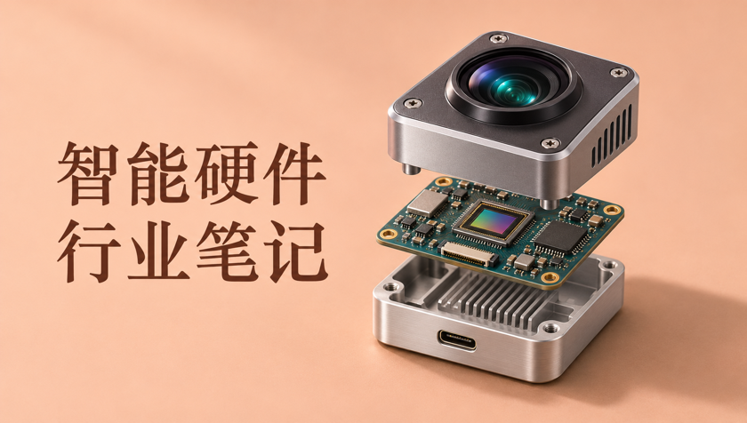

# 智能硬件行业知识分享

围绕 **2026 千问智能硬件三大赛道（智能眼镜、智能录音设备、智能儿童陪伴玩具）** 的行业深度洞察、全链路云算力账本与商业化研判，以及智能玩具硬件合作、模型选型、成本与采购的一线专题笔记。

## 2026 千问智能硬件三大赛道行业洞察与商业化汇报

> 每份汇报均提供 **16:9 交互演示版（HTML，支持键盘翻页 / 全屏 / 总览）** 与 **高清文档版（PDF）**，已完成多轮行业总监视角数据核验、全链路云成本复算与法规口径校准（截至 2026 年 11 月）。

| 编号与优先级 | 赛道主题 | 核心聚焦问题与看点 | 在线演示（HTML） | 高清文档（PDF） |
| --- | --- | --- | --- | --- |
| **00 · 协同总览** | 千问智能硬件三大赛道协同格局与商业化总览（5 页） | 一页拉齐三赛道核验数据口径、全链路百炼/听悟云账、外部标杆重排与 90 天推进节奏 | [在线演示](https://youngting520.github.io/%E6%99%BA%E8%83%BD%E7%A1%AC%E4%BB%B6%E8%A1%8C%E4%B8%9A%E7%9F%A5%E8%AF%86%E5%88%86%E4%BA%AB/reports/00_%E5%8D%83%E9%97%AE%E6%99%BA%E8%83%BD%E7%A1%AC%E4%BB%B6%E4%B8%89%E5%A4%A7%E8%B5%9B%E9%81%93%E5%8D%8F%E5%90%8C%E6%80%BB%E8%A7%88_%E6%B1%87%E6%8A%A5%E7%89%88.html) | [查看 PDF](./reports/00_千问智能硬件三大赛道协同总览_汇报版.pdf) |
| **01 · 其次推进** | 智能眼镜：2026 行业深度洞察与千问商业化汇报（18 页） | Q3 量增额降与四分形态、高通 AR1 双芯 BOM、视光门店净贡献、含 TTS/VLM/实时流全链路云账与雷鸟/Rokid 切口 | [在线演示](https://youngting520.github.io/%E6%99%BA%E8%83%BD%E7%A1%AC%E4%BB%B6%E8%A1%8C%E4%B8%9A%E7%9F%A5%E8%AF%86%E5%88%86%E4%BA%AB/reports/01_%E6%99%BA%E8%83%BD%E7%9C%BC%E9%95%9C_2026%E8%A1%8C%E4%B8%9A%E6%B7%B1%E5%BA%A6%E6%B4%9E%E5%AF%9F%E4%B8%8E%E5%8D%83%E9%97%AE%E5%95%86%E4%B8%9A%E5%8C%96%E6%B1%87%E6%8A%A5.html) | [查看 PDF](./reports/01_智能眼镜_2026行业深度洞察与千问商业化汇报.pdf) |
| **02 · 优先推进** | 智能录音设备：2026 行业深度洞察与千问商业化汇报（18 页） | 国内办公格局与企微联盟、Plaud 海外订阅与耳机跨界、完整单机贡献利润、北京/新加坡全档位云账与声纹合规 | [在线演示](https://youngting520.github.io/%E6%99%BA%E8%83%BD%E7%A1%AC%E4%BB%B6%E8%A1%8C%E4%B8%9A%E7%9F%A5%E8%AF%86%E5%88%86%E4%BA%AB/reports/02_%E6%99%BA%E8%83%BD%E5%BD%95%E9%9F%B3%E8%AE%BE%E5%A4%87_2026%E8%A1%8C%E4%B8%9A%E6%B7%B1%E5%BA%A6%E6%B4%9E%E5%AF%9F%E4%B8%8E%E5%8D%83%E9%97%AE%E5%95%86%E4%B8%9A%E5%8C%96%E6%B1%87%E6%8A%A5.html) | [查看 PDF](./reports/02_智能录音设备_2026行业深度洞察与千问商业化汇报.pdf) |
| **03 · 有条件推进** | 智能儿童陪伴玩具：2026 行业洞察与千问商业化汇报（18 页） | 广义/狭义口径拆解、199 白牌 30% 退货亏损真相、2 年高活+RTC 压测、中美 2026 强监管红线与预付费卡密闭环 | [在线演示](https://youngting520.github.io/%E6%99%BA%E8%83%BD%E7%A1%AC%E4%BB%B6%E8%A1%8C%E4%B8%9A%E7%9F%A5%E8%AF%86%E5%88%86%E4%BA%AB/reports/03_%E6%99%BA%E8%83%BD%E5%84%BF%E7%AB%A5%E9%99%AA%E4%BC%B4%E7%8E%A9%E5%85%B7_2026%E8%A1%8C%E4%B8%9A%E6%B7%B1%E5%BA%A6%E6%B4%9E%E5%AF%9F%E4%B8%8E%E5%8D%83%E9%97%AE%E5%95%86%E4%B8%9A%E5%8C%96%E6%B1%87%E6%8A%A5.html) | [查看 PDF](./reports/03_智能儿童陪伴玩具_2026行业深度洞察与千问商业化汇报.pdf) |

## 智能玩具硬件合作与模型采购专题笔记

从千问与硬件伙伴的合作出发，了解一款智能玩具怎样选模型、做成产品，以及品牌如何估算成本和决定采购。

| 主题 | 想弄清的问题 | 文章 |
| --- | --- | --- |
| 合作伙伴 | 谁给谁交钥匙？利尔达、广和通和涂鸦的做法有什么差别？ | [千问与涂鸦的交钥匙方案由谁交给谁](./千问与涂鸦的交钥匙方案由谁交给谁.md) |
| 合作伙伴专题 | 模型怎样进入毛绒包挂？哪些工作在设备上完成？ | [千问与广和通怎样把模型装进智能玩具](./千问与广和通怎样把模型装进智能玩具.md) |
| 品牌与产品 | Walulu 的品牌、深励科技和涂鸦各自做了什么？ | [Walulu 从模型选型到产品上架](./Walulu%20从模型选型到产品上架.md) |
| 模型与技术 | Flash、Plus、Max 和 4B、8B 各指什么？ | [智能玩具怎样选千问模型与参数尺寸](./智能玩具怎样选千问模型与参数尺寸.md) |
| 商业条款 | 一台玩具每年要付多少 AI 服务费？ | [一台联网玩具的年度 AI 成本怎么算](./一台联网玩具的年度%20AI%20成本怎么算.md) |
| 竞争与采购 | 千问、豆包、DeepSeek 都能接入，谁作决定？ | [千问与豆包等模型怎样赢得玩具品牌采购](./千问与豆包等模型怎样赢得玩具品牌采购.md) |
| 访谈提纲 | 品牌为什么选这个模型、量产后实际调用多少、次年由谁续费？ | [智能玩具模型采购访谈提纲](./智能玩具模型采购访谈提纲.md) |
