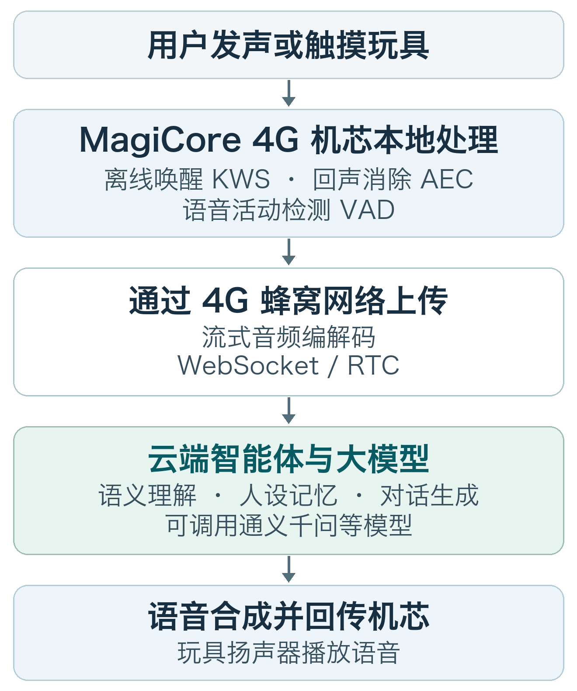

# 千问与广和通怎样把模型装进智能玩具

2025 年 2 月，通信模组厂商广和通宣布与阿里云达成合作，面向消费电子终端推出“随身智能解决方案”。按照双方联合披露的分工，阿里云提供通义千问的端侧与云端模型能力，广和通负责把模型适配进无线通信模组与终端硬件方案中，面向翻译机、陪伴机器人和智能玩具等品类交付。双方商业化及市场负责人均将这一合作定位为降低端侧 AI 应用门槛、推动消费电子商业化落地的重要节点。

相比主打云端开发者生态的 IoT 平台，广和通提供了一个更贴近物理硬件的观察切口：**一只毛绒玩具内部究竟塞进了什么电子部件？哪些计算真的在设备上完成，哪些仍在云端？**

## 一只毛绒包挂怎样用上千问

把两条不同时间的公开报道拼在一起，可以完整还原一款具体落地产品的硬件方案与模型对应关系：

- **2025 年 12 月 23 日**，在大湾区 AI 玩具产业创新发展大会上，广和通将**“食梦貘 AI 毛绒包挂”**列为自身 **MagiCore 2.0** 轻算力陪伴方案的代表性落地案例；
- **2026 年 1 月 10 日**，《科创板日报》在报道阿里云通义智能硬件展（1 月 8 日至 11 日）时披露，这款食梦貘 AI 包挂内置广和通 MagiCore 2.0 轻算力陪伴解决方案，**搭载通义千问大模型**，支持打造个性化 IP 智能体。

所谓“机芯”，就是能直接装进毛绒玩具肚子里的超小型电子模组盒。根据广和通 MagiCore 官方方案页披露，其面向毛绒、桌宠和亲子陪伴的整套交付包含四个部分：**超小型 4G AI 机芯盒、OpenSDK、公版/可定制 App 以及 FIBO 云端管理平台**。它的典型端云协同流程如下：

[查看高清原图](./assets/magicore-voice-path.png)

采用机芯盒可以缩短蜂窝联网和语音前处理的集成时间，品牌方可以在云端和 App 上定制角色与音色。装入毛绒外壳后，仍需验证整机的拾音、回声和续航表现，再通过试产检查装配质量。公开报道尚未披露食梦貘具体调用哪一档千问模型，也未公布各类交互请求的分流细节。

## 什么叫让模型在设备上运行：别混淆两类完全不同的硬件

广和通的公开技术资料里，除了轻算力 4G 机芯，还有一条高关注度的“端侧部署大模型”主线：

- **2025 年 6 月 25 日**，在阿里云主办的“扬州毛绒玩具 AI 火花创新峰会”上，广和通展示了接入千问的智能玩具，以及 **Qwen3 系列模型（0.6B / 1.7B / 4B / 8B）** 在设备本地运行的演示——其 AI 研究院团队针对模型结构设计了混合精度量化方案，并在**高通 QCS8550** 平台深度优化推理性能；
- **2026 年 1 月 15 日**，在成都高通边缘智能开发者生态大会上，广和通又展示了基于高通 QCS8550 平台，将自研端侧语音识别（ASR）、语音合成（TTS）与千问视觉语言模型 **Qwen2-VL** 在设备端协同运行的方案。

看到这两组案例，很多刚入行的读者容易产生错觉：“既然能把 Qwen3-8B 装进设备，那两百元左右的毛绒包挂是不是也能断网跑 8B 大模型？”**从硬件物理约束和 BOM 成本看，这两类方案几乎属于两个完全不同的产品世界：**

| 对比维度 | 轻算力 4G 机芯路线（如 MagiCore 2.0） | 高算力端侧大模型路线（如 QCS8550 演示平台） |
| :--- | :--- | :--- |
| **本地完成的工作** | 离线唤醒（KWS）、回声消除（AEC）、降噪、VAD、流式编解码与 4G 传输 | 本地直接运行量化后的 LLM / VLM（如 Qwen3-0.6B～8B、Qwen2-VL）及端侧 ASR/TTS |
| **大模型推理位置** | **云端完成**（依赖 4G / Wi-Fi 联网） | **设备本地为主**，或“端侧兜底 + 云端协同” |
| **体积、功耗与续航** | 超小尺寸、低功耗，适配毛绒包挂的小容量锂电池 | 需要高性能 NPU、数 GB 级大内存与散热空间，功耗显著更高 |
| **硬件 BOM 量级** | 面向百元至数百元级消费潮玩与随身毛绒挂件 | 旗舰边缘计算模组本身成本动辄数百至千元级，适配高端陪伴机器人、学习机、智算盒、智能座舱 |
| **公开证据能证明什么** | 证明轻量化 4G 机芯已具备毛绒包挂商用形态 | 证明广和通具备端侧量化与高通平台推理优化的工程储备，不代表普通毛绒玩具本地运行 8B |

因此，对于硬件团队而言，这是两道独立的选择题：走量级毛绒玩具优先用轻算力机芯换取体积、续航和零售价空间；只有在强调强隐私、弱网/离线可用且客单价足够高的中高端终端上，评估端侧 4B/8B 才具备商业合理性。

## 各方投入什么，各自赚哪一段的价值

- **阿里云千问**：提供端侧开源权重与云端模型服务，借助广和通长期积累的终端硬件客户网络进入选型清单。端侧适配有助于扩大千问的技术生态覆盖，但要转化为持续的云端 API 或订阅收入，仍取决于量产设备的联网激活数与实际云端调用量。
- **广和通**：从单一的无线通信模组供应商，升级为“4G 机芯盒 + 端侧音频/AI 算法 + 公版 App + FIBO 云管理”的一体化方案商。其公开资料特别强调，MagiCore 支持**整合移动网络流量与大模型服务资费**，借此把一次性硬件出货延伸为持续的流量与云服务运营。
- **玩具品牌方**：免去了分别对接芯片厂、运营商流量、语音算法团队和大模型云平台的碎片化工程成本，把研发资源集中到 IP 塑造、外观工艺与渠道销售上。

> [!NOTE]
> 以上是基于公开交付清单判断的商业价值分工；签约各方之间的具体模组售价、流量分成与云服务结算条款，仍以项目商业合同为准。

## 商业归因审视：翻开年报与展会清单，如何核实千问的真实份额

要判断广和通的 AI 玩具进展有多少能真正归因到千问，上市公司定期报告与后续展品信息是最硬的校验尺：

1. **广和通 2025 年年报分别披露了机芯方案的使用情况和云平台已对接的模型。**
   - 第 27 页的“AI 玩具解决方案”一栏显示，**MagiCore 2.0 解决方案已上市，已有部分客户小批量使用**。公司将 2026 年实现更多客户规模商用列为目标。
   - 在云平台布局中写明：公司推出的 **Fibocom AI Cloud** 平台已对接**豆包、千问、扣子、DeepSeek、OpenAI** 等主流大模型及智能体平台（同时，年报还披露广和通于 2025 年 6 月发布的车联网 AI 语音智能体 FiboVista 率先对接了豆包大模型）。
2. **新落地案例不一定默认搭载千问**：在 2026 年 MWC 上海展上，广和通又重点展示了两款采用 MagiCore 方案的落地产品——**南通城市 IP“通通”智能体**与 **AiMOON 星座 AI 潮玩**。官方说明确认了二者采用 MagiCore 实现 4G 联网、大模型语音交互与 IP Agent 定制，但均未指明底层调用的是哪一家大模型。
3. **怎样核实千问的实际份额。** 涂鸦的“交钥匙”重在云端开发框架与多模型工作台，广和通的“随身智能 / MagiCore”重在可直接装入玩具的 4G 机芯与端侧算力延展。两家均支持多模型。年报披露的客户使用进展没有列出终端产品名称和数量。要判断食梦貘为千问带来了多少业务，还需核实该款产品的销量、联网激活数，以及实际路由到千问的云端调用量。

## 接着读

- [对照千问与涂鸦的交钥匙方案，对比涂鸦、利尔达与广和通三类伙伴的交付差异](./千问与涂鸦的交钥匙方案由谁交给谁.md)
- [从 0.6B～8B 的端侧适配出发，看清智能玩具怎样选语音架构、云端档位与参数尺寸](./智能玩具怎样选千问模型与参数尺寸.md)
- [算一台联网玩具的年度 AI 成本，把 4G 流量费与云端模型费放进同一张表](./一台联网玩具的年度%20AI%20成本怎么算.md)

[返回「智能硬件行业知识分享」目录](./README.md)

---

## 参考信源

*资料核对日期：2026 年 11 月 27 日*

1. 广和通官网新闻（2025-02）：[基于阿里云通义大模型推出随身智能解决方案，赋能消费电子终端行业](https://www.fibocom.com/newscenter/info_itemid_8581.html)
2. 广和通官网新闻（2025-06）：[阿里云扬州玩具 AI 火花会，广和通携端云协同 AI 方案来了](https://www.fibocom.com/newscenter/info_itemid_8686.html)
3. 广和通官网新闻（2025-12）：[广和通 MagiCore 2.0 斩获 AI 玩具技术创新大奖（含食梦貘等落地展品）](https://www.fibocom.com/newscenter/info_itemid_9873.html)
4. 广和通官网新闻：[MagiCore AI 轻量化大模型方案资费整合说明](https://www.fibocom.com/newscenter/info_itemid_9747.html)
5. 广和通官方方案页：[AI 陪伴解决方案 · MagiCore 机芯盒](https://www.fibocom.com/IndustrySolutions/index_itemid_8997.html)
6. 《科创板日报》（2026-01-10）：[阿里云全面“杀入”AI 硬件（深圳阿里云通义智能硬件展现场报道）](https://m.cls.cn/detail/2253784)
7. 广和通官网新闻（2026-01）：[广和通受邀高通边缘智能开发者生态大会（QCS8550 与 Qwen2-VL 展示）](https://www.fibocom.com/newscenter/info_itemid_10077.html)
8. 深圳证券交易所公告（2026-03-31）：[广和通 2025 年年度报告（第 27 页“AI 玩具解决方案”，云平台见全文“Fibocom AI Cloud”）](https://disc.static.szse.cn/download/disc/disk03/finalpage/2026-03-31/650fc85e-eb03-49f7-bddd-6442bd85754f.PDF#page=27)
9. 广和通官网新闻（2026-06）：[广和通在 MWC 上海一展 AI 布局（“通通”智能体与 AiMOON 潮玩）](https://www.fibocom.com/newscenter/info_itemid_11202.html)
