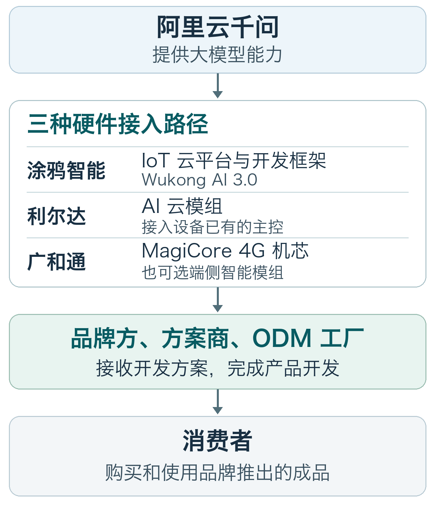

# 千问与涂鸦的交钥匙方案由谁交给谁

2026 年 4 月的 TUYA 全球开发者大会上，阿里云千问智能硬件业务负责人宣布，将千问大模型能力与涂鸦智能的 AI+IoT 平台深度融合，共同打造一站式“交钥匙（Turnkey）”AI 硬件开发方案。

刚接触智能硬件的读者，看到“交钥匙”容易产生一个误解：是不是大模型厂商和物联网平台联手，直接做好成品卖给消费者？

**这把“钥匙”交给玩具品牌、ODM 工厂和硬件方案商。** 上游预先打通模型接口、联网模组和云端运维，品牌方可以把更多精力放在人群定义、IP 人设、工业外观和体验打磨上。整机仍要经过验证和试产，消费者最终买到的是品牌方定义并负责售后的成品。

[查看高清原图](./assets/hardware-delivery.png)。涂鸦和广和通的平台也支持豆包、DeepSeek 等模型，每款设备实际采用的模型取决于品牌和方案商的选型。

## 各方投入什么，各自赚哪一段的钱

拆开一条完整的 AI 玩具交付链路，三类角色各自掌握的筹码与长期收益并不相同：

- **阿里云千问（模型与交互底座）**：提供可供设备端调用的千问系列大模型能力。在实际落地中，品牌接触千问其实有两条路径——一是经由涂鸦等第三方平台的工作台间接调用；二是直接接入阿里云自家的**百炼多模态交互开发套件**（已将千问、万相、百聆三款通义模型及语音识别、语音合成、SDK 打包整合）。与涂鸦合作的核心商业诉求，是借涂鸦已有的全球开发者与硬件客户池，让千问进入更多量产产品的备选与评测名单。
- **涂鸦智能（平台与工程中枢）**：提供 **Wukong AI 3.0** 硬件开发框架、云端智能体开发工作台、标准参考工程，并按项目需要叠加模组、公版/OEM App 和供应链支持。对涂鸦而言，硬件联网接入只是起点，设备卖出去后持续产生的智能体“资源点”消耗、云服务与增值订阅，才是更具想象空间的续费业务。
- **品牌及其方案商（产品定义与商业闭环）**：决定目标人群、角色性格、外观工艺、BOM 成本红线与线上线下渠道，并对最终的交互体验与售后服务兜底。借助交钥匙方案省下的不是“整个产品研发”，而是底层的通信、鉴权、音视频链路和模型对接工期。

> [!NOTE]
> 以上梳理的是产业链各环节的常规价值分工；具体项目中谁向谁采购、硬件与云服务是否打包结算、毛利如何分配，仍以各签约方的商业合同为准。

## 与利尔达、广和通对照：三条“硬件伙伴”路径差在哪

在千问的硬件生态里，涂鸦并非唯一强调“快速交付”的伙伴。同样面向消费电子与智能玩具，**涂鸦、利尔达、广和通**代表了三种截然不同的切入方式：

### 涂鸦智能（IoT 平台型）

- **核心方案**　Wukong AI 3.0 框架 + 涂鸦 AI 云平台
- **硬件接入方式**　模组 + TuyaOS / 开发者工作台与 App 生态
- **主力联网形态**　Wi-Fi / 蓝牙为主，兼顾全屋智能生态联动
- **公开成本 / 周期锚点**　按“资源点”计量（含部分每日免费额度），主打快速模型匹配
- **模型生态立场**　中立多模型工作台（千问、豆包、DeepSeek、海外模型等可选）
- **最适配的客户**　需要现成 App、有出海需求、希望灵活切换多模型的品牌

### 利尔达（性价比模组型）

- **核心方案**　端-云-AI 一站式模组 / AI 云卡 / AI 云盒
- **硬件接入方式**　通过串口或 I/O 口直连客户自有主控，上电即用
- **主力联网形态**　Wi-Fi 4 / BLE 6.0（入门款），可选 Cat.1 + eSIM
- **公开成本 / 周期锚点**　**9.9 元起**（Wi-Fi 模组含首年大模型服务）。利尔达对自家方案提出“1515”开发目标：1 天验证原型、5 天开发样机、15 天进入量产准备。整机交期另行约定。
- **模型生态立场**　与阿里云千问深度联合推出打包方案
- **最适配的客户**　BOM 成本极其敏感、希望低门槛改造存量产品的玩具/小家电厂

### 广和通（蜂窝机芯 + 端侧算力型）

- **核心方案**　MagiCore 2.0 轻算力 4G 机芯 / 高通端侧智能模组
- **硬件接入方式**　超小型 4G 机芯盒直接装入玩具，配 OpenSDK 与公版 App
- **主力联网形态**　强项在 4G 蜂窝移动联网，适配随身毛绒包挂与户外场景
- **公开成本 / 周期锚点**　整合 4G 流量与大模型服务资费，硬件与云服务走项目制报价
- **模型生态立场**　Fibocom AI Cloud 中立对接多模型（千问、豆包、DeepSeek、OpenAI 等）
- **最适配的客户**　做 4G 随身潮玩、文旅 IP 包挂，或探索中高端端侧算力的厂商

同样是帮模型进入硬件，**涂鸦提供开发平台和多模型工作台，利尔达以 9.9 元起的模组打包首年服务，广和通把 4G 机芯与通信资费整合用于随身场景，也提供高算力端侧方案**。

## 商业归因审视：合作官宣之后，还要追问哪三步

站在观察千问硬件生态与商业化进展的研报视角，“签下头部硬件伙伴”只是故事的第一章。要判断这类“交钥匙”合作究竟为千问带来了多少真实商业增量，还需要顺着产业链向下核验三个关键环节：

1. **品牌选了哪个模型？** 涂鸦 AI 开发平台与广和通 Fibocom AI Cloud 都支持多家模型。平台接入让千问进入候选名单，具体产品采用哪家、哪个版本，还要看品牌或方案商的选型记录。
2. **量产后产生了多少调用？** 展品说明方案已有公开展示。判断具体产品是否通过量产验证，要看整机验证和试产结果。估算千问的实际调用量，还要核对出货台数、激活率、上线后的对话轮次，以及其中有多少请求发给了千问。
3. **哪部分收入归模型厂商？** 模组商或 IoT 平台可以把硬件、流量与首年 AI 额度合并报价。公开打包价无法倒推出上游净收入。核算时要先确认合同按设备授权还是按实际调用结算，再看对应的数量和结算单价。

## 接着读

- [看广和通怎样把模型装进毛绒包挂，区分轻算力机芯与高算力端侧芯片](./千问与广和通怎样把模型装进智能玩具.md)
- [看 Walulu 案例，拆解品牌、IoT 平台与垂直方案商在爆款里的分工](https://youngting520.github.io/智能硬件行业知识分享/Walulu%20从模型选型到产品上架.html)
- [算一台联网玩具的年度 AI 成本，看清预付订阅、按量计费与隐性账单](https://youngting520.github.io/智能硬件行业知识分享/一台联网玩具的年度%20AI%20成本怎么算.html)
- [看千问与豆包等模型如何在玩具品牌采购中同台竞争](./千问与豆包等模型怎样赢得玩具品牌采购.md)
- [用访谈提纲让方案商说明交付边界，再向品牌和云厂商核对谁付款、谁结算](./智能玩具模型采购访谈提纲.md)

[返回「智能硬件行业知识分享」目录](./README.md)

---

## 参考信源

*资料核对日期：2026 年 11 月 27 日*

1. 涂鸦智能官网新闻（2026-04-23）：[亚马逊云科技、阿里云、火山引擎等全球 AI 伙伴齐聚，涂鸦智能开发者大会共话 AI 应用生态](https://www.tuya.com/cn/news-details/Kfkezor2hiqki)
2. 涂鸦开发者文档：[Wukong AI 3.0 硬件开发框架](https://developer.tuya.com/cn/docs/iot/embedded-tuyaos-wukong-3-0?id=Kfnwpxkxm0tpc) · [智能体计量计费说明](https://developer.tuya.com/cn/docs/iot/ai-agent-price?id=Kegb2s2shaj4d)
3. 阿里云产品页：[百炼多模态交互开发套件](https://www.aliyun.com/product/bailian/multi-modal-app)
4. 利尔达官网资讯：[文博会端-云-AI 交钥匙方案报道](https://www.lierda.com/about-us/news-center/iot-module-news/2685) · [利尔达携手阿里千问推出 9.9 元 AI 云模组](https://www.lierda.com/about-us/news-center/oldnews/2736) · [2026 年 9 月 4 日行业演讲对“量产准备”的说明](https://www.lierda.com/about-us/news-center/guang/2749)
5. 广和通官网资讯：[基于阿里云通义大模型推出随身智能解决方案](https://www.fibocom.com/newscenter/info_itemid_8581.html) · [MagiCore AI 陪伴机芯盒方案页](https://www.fibocom.com/IndustrySolutions/index_itemid_8997.html)
