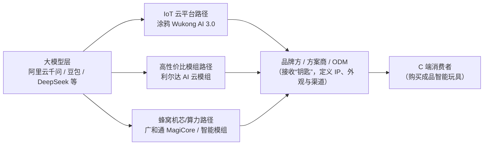

# 千问与涂鸦的交钥匙方案由谁交给谁

2026 年 4 月的 TUYA 全球开发者大会上，阿里云千问智能硬件业务负责人宣布，将千问大模型能力与涂鸦智能的 AI+IoT 平台深度融合，共同打造一站式“交钥匙（Turnkey）”AI 硬件开发方案。

刚接触智能硬件的读者，看到“交钥匙”容易产生一个误解：是不是大模型厂商和物联网平台联手，直接做好成品卖给消费者？

恰恰相反。**这把“钥匙”交的对象不是消费者，而是玩具品牌、ODM 工厂和硬件方案商。** 上游把模型接口、开发框架、联网模组与云端运维预先打通，品牌方接过“钥匙”后，只需把精力放在人群定义、IP 人设、工业外观、体验打磨与销售渠道上，不必从零组建大模型和物联网工程团队；消费者最终拿到并买单的，依然是品牌方定义和售后的成品。

## 各方投入什么，各自赚哪一段的钱

拆开一条完整的 AI 玩具交付链路，三类角色各自掌握的筹码与长期收益并不相同：

- **阿里云千问（模型与交互底座）**：提供可供设备端调用的千问系列大模型能力。在实际落地中，品牌接触千问其实有两条路径——一是经由涂鸦等第三方平台的工作台间接调用；二是直接接入阿里云自家的**百炼多模态交互开发套件**（已将千问、万相、百聆三款通义模型及语音识别、语音合成、SDK 打包整合）。与涂鸦合作的核心商业诉求，是借涂鸦已有的全球开发者与硬件客户池，让千问进入更多量产产品的备选与评测名单。
- **涂鸦智能（平台与工程中枢）**：提供 **Wukong AI 3.0** 硬件开发框架、云端智能体开发工作台、标准参考工程，并按项目需要叠加模组、公版/OEM App 和供应链支持。对涂鸦而言，硬件联网接入只是起点，设备卖出去后持续产生的智能体“资源点”消耗、云服务与增值订阅，才是更具想象空间的续费业务。
- **品牌及其方案商（产品定义与商业闭环）**：决定目标人群、角色性格、外观工艺、BOM 成本红线与线上线下渠道，并对最终的交互体验与售后服务兜底。借助交钥匙方案省下的不是“整个产品研发”，而是底层的通信、鉴权、音视频链路和模型对接工期。

> [!NOTE]
> 以上梳理的是产业链各环节的常规价值分工；具体项目中谁向谁采购、硬件与云服务是否打包结算、毛利如何分配，仍以各签约方的商业合同为准。

## 与利尔达、广和通对照：三条“硬件伙伴”路径差在哪

在千问的硬件生态里，涂鸦并非唯一强调“快速交付”的伙伴。同样面向消费电子与智能玩具，**涂鸦、利尔达、广和通**代表了三种截然不同的切入方式：

| 对比维度 | 涂鸦智能（IoT 平台型） | 利尔达（性价比模组型） | 广和通（蜂窝机芯 + 端侧算力型） |
| :--- | :--- | :--- | :--- |
| **核心方案** | Wukong AI 3.0 框架 + 涂鸦 AI 云平台 | 端-云-AI 一站式模组 / AI 云卡 / AI 云盒 | MagiCore 2.0 轻算力 4G 机芯 / 高通端侧智能模组 |
| **硬件接入方式** | 模组 + TuyaOS / 开发者工作台与 App 生态 | 通过串口或 I/O 口直连客户自有主控，上电即用 | 超小型 4G 机芯盒直接装入玩具，配 OpenSDK 与公版 App |
| **主力联网形态** | Wi-Fi / 蓝牙为主，兼顾全屋智能生态联动 | Wi-Fi 4 / BLE 6.0（入门款），可选 Cat.1 + eSIM | 强项在 4G 蜂窝移动联网，适配随身毛绒包挂与户外场景 |
| **公开成本 / 周期锚点** | 按“资源点”计量（含部分每日免费额度），主打快速模型匹配 | **9.9 元起**（打包 Wi-Fi 模组 + 1 年大模型服务），主打“1515”开发节奏（1 天原型 / 5 天样机 / 15 天量产） | 整合 4G 流量与大模型服务资费，硬件与云服务走项目制报价 |
| **模型生态立场** | 中立多模型工作台（千问、豆包、DeepSeek、海外模型等可选） | 与阿里云千问深度联合推出打包方案 | Fibocom AI Cloud 中立对接多模型（千问、豆包、DeepSeek、OpenAI 等） |
| **最适配的客户** | 需要现成 App、有出海需求、希望灵活切换多模型的品牌 | BOM 成本极其敏感、希望低门槛改造存量产品的玩具/小家电厂 | 做 4G 随身潮玩、文旅 IP 包挂，或探索中高端端侧算力的厂商 |

对照三家可以看出：同样是帮模型进入硬件，**涂鸦卖的是“全栈开发者生态与多模型工作台”，利尔达用“9.9 元含首年服务”击穿中小厂商的试错门槛，广和通则凭借 4G 机芯形态与通信资费整合切入随身场景，并同步卡位高算力端侧部署**。

## 商业归因审视：合作官宣之后，还要追问哪三步

站在观察千问硬件生态与商业化进展的研报视角，“签下头部硬件伙伴”只是故事的第一章。要判断这类“交钥匙”合作究竟为千问带来了多少真实商业增量，还需要顺着产业链向下核验三个关键环节：

1. **渠道上架 ≠ 独家选用**：涂鸦（AI 开发平台）与广和通（Fibocom AI Cloud）在商业立场上天然保持**多模型中立**——在 2026 年的涂鸦开发者大会上，阿里云千问、火山引擎豆包与亚马逊云科技等均同台亮相。平台集成给千问带来的是“进入候选池”的分发效率，但最终由品牌方或方案商在工作台勾选哪一家模型，取决于实测延迟、角色感与单价。
2. **协议曝光 ≠ 实际云调用量**：一场大会或一批展品只能证明“方案已跑通”。真正转化为模型厂商调用量与收入的，必须穿透到**量产出货台数 → 开机激活率 → 上线数月后的留存对话轮次**三个漏斗。
3. **打包转售 ≠ 同一份单台收入**：如果品牌直接采购阿里云百炼套件，模型层的调用与订阅归属清晰；如果经由模组商或 IoT 平台打包转售（例如把硬件、流量与首年 AI 额度合并定价），上游模型厂商实际拿到的单台净收入会与公开标价存在折让，需要结合具体计费模式来反推。

## 接着读

- [看广和通怎样把模型装进毛绒包挂，区分轻算力机芯与高算力端侧芯片](./千问与广和通怎样把模型装进智能玩具.md)
- [看 Walulu 案例，拆解品牌、IoT 平台与垂直方案商在爆款里的分工](./Walulu%20从模型选型到产品上架.md)
- [算一台联网玩具的年度 AI 成本，看清预付订阅、按量计费与隐性账单](./一台联网玩具的年度%20AI%20成本怎么算.md)
- [看千问与豆包等模型如何在玩具品牌采购中同台竞争](./千问与豆包等模型怎样赢得玩具品牌采购.md)

[返回「智能硬件行业知识分享」目录](./README.md)

---

## 参考信源

*资料核对日期：2026 年 11 月 26 日*

1. 涂鸦智能官网新闻（2026-04-23）：[亚马逊云科技、阿里云、火山引擎等全球 AI 伙伴齐聚，涂鸦智能开发者大会共话 AI 应用生态](https://www.tuya.com/cn/news-details/Kfkezor2hiqki)
2. 涂鸦开发者文档：[Wukong AI 3.0 硬件开发框架](https://developer.tuya.com/cn/docs/iot/embedded-tuyaos-wukong-3-0?id=Kfnwpxkxm0tpc) · [智能体计量计费说明](https://developer.tuya.com/cn/docs/iot/ai-agent-price?id=Kegb2s2shaj4d)
3. 阿里云产品页：[百炼多模态交互开发套件](https://www.aliyun.com/product/bailian/multi-modal-app)
4. 利尔达官网资讯：[文博会端-云-AI 交钥匙方案报道](https://www.lierda.com/about-us/news-center/iot-module-news/2685) · [利尔达携手阿里千问推出 9.9 元 AI 云模组](https://www.lierda.com/about-us/news-center/oldnews/2736)
5. 广和通官网资讯：[基于阿里云通义大模型推出随身智能解决方案](https://www.fibocom.com/newscenter/info_itemid_8581.html) · [MagiCore AI 陪伴机芯盒方案页](https://www.fibocom.com/IndustrySolutions/index_itemid_8997.html)
