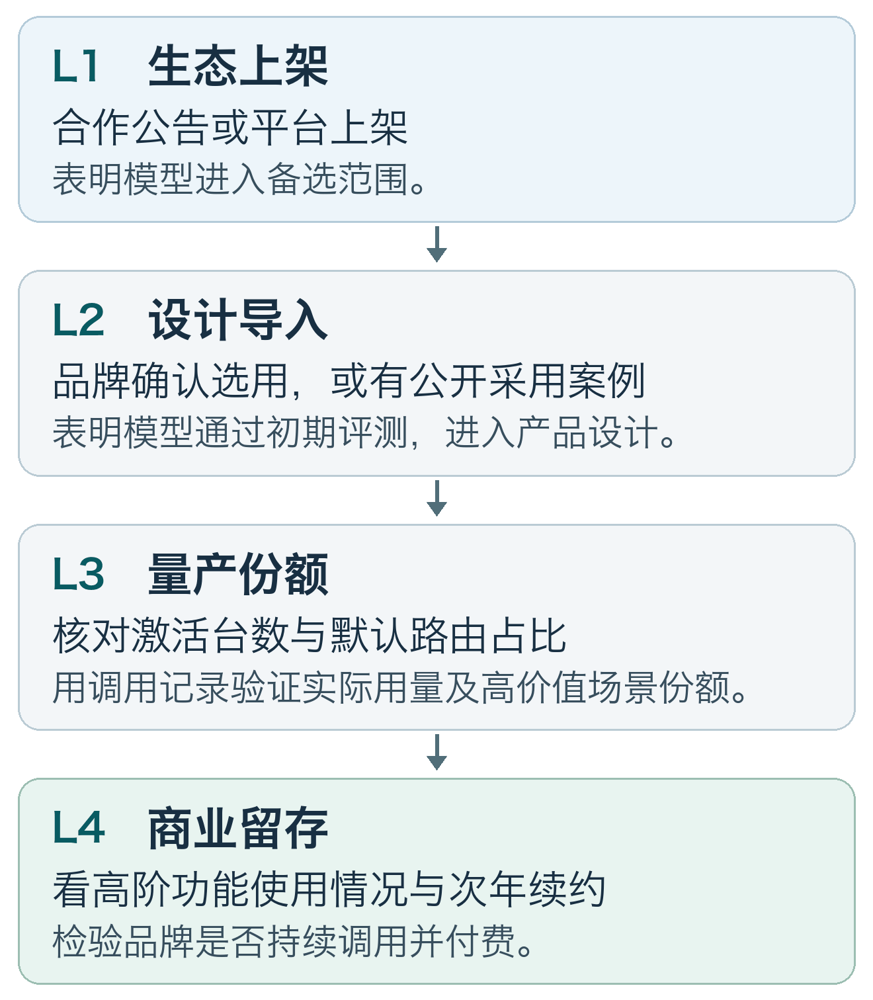

# 千问与豆包等模型怎样赢得玩具品牌采购

进入涂鸦 AI 开发平台或广和通 Fibocom AI Cloud 等中立硬件平台后，品牌方和方案商会发现一个共同现实：**大模型不再是“唯一选项”，而是工作台里的下拉菜单。**

涂鸦开发文档把模型配置入口直接开放给开发者工作台（具体可用模型受数据中心区域和合规条件影响）；广和通 2025 年年报也披露，其 AI 云平台已并行对接豆包、千问、扣子、DeepSeek、OpenAI 等主流模型。至于消费者买回家后能否自行切换模型，则取决于品牌 App 是否开放该设置。

正因为中立平台天然倾向“多模型并存”以增强自身对上游的议价权，**上架平台只给模型厂商换来一张“被比较的入场券”**。真正决定谁拿下量产订单的，是品牌方在真机评测与商业账本上的横向对比。

## 竞品格局：千问、豆包与 DeepSeek 在玩具赛道各凭什么拿单

在当前国内智能玩具品牌的备选池里，最常被放在同一张对比表上的三家模型阵营是**阿里云千问**、**火山引擎豆包**和 **DeepSeek**，三者在交付形态与核心优势上有明显分化：

| 对比维度 | 阿里云 · 千问（Qwen） | 火山引擎 · 豆包（Doubao） | DeepSeek |
| :--- | :--- | :--- | :--- |
| **硬件交付形态** | 百炼多模态交互开发套件（含千问/万相/百聆及 2～10 元/台/年设备订阅）+ 涂鸦、广和通、利尔达等广泛模组生态 | 实时音视频（RTC）底座 + 硬件对话智能体 + 扣子（Coze）智能体生态 | 以纯大模型 API 与开源权重为主，通常作为中立平台（如涂鸦、广和通）中的模型选项被集成 |
| **核心竞争优势** | ① 全尺寸开源矩阵，端云一体可演进；② Flash/Plus/Max 分档清晰，预付订阅起购门槛极低；③ 传统玩具与物联网模组产业链协同广 | ① 实时语音交互、低延迟自然打断（RTC）与高拟人情绪音色口碑强；② C 端情绪陪伴爆款验证与内容角色生态成熟 | ① 复杂推理与长故事创作性价比高；② 开源社区活跃，适合作为多模型路由中的复杂任务分支 |
| **选型关注点** | 需在真机上对比级联语音与端到端全模态的延迟表现，并核算高倍率模型与拟人音色的组合成本 | 若产品要求多芯片深度私有化部署或轻量开源模型端侧离线运行，需额外评估开源替代方案 | 本身不提供硬件模组及全套 RTC/ASR/TTS 语音链路，品牌需依赖 IoT 平台或方案商完成端云集成 |
| **典型适配场景** | 强调低单台年费预算、多产品形态扩展、端云协同与多语言出海的硬件品牌 | 主打强情绪陪伴、高频口语闲聊、把“拟人声线与极速打断”当核心卖点的潮玩 | 常作为多模型平台中的补充大脑，用于百科问答、长剧情生成等特定高推理分支 |

> [!NOTE]
> **出海品牌的额外必答题**：如果产品计划销往欧美、日韩市场，模型采购还必须叠加三项硬约束——目标区域的云数据中心部署、儿童隐私与内容法规合规（如美国 COPPA、欧盟 GDPR），以及与海外模型（如 GPT、Gemini）在同一套开发框架下的切换能力。

## 品牌可以怎样在同一台硬件上做一轮真对比

避免被 PPT 跑分和理想网络下的 Demo 误导，品牌方在定型前可以用同一款工程样机走完四步实战评测：

1. **日常高频对话：盯 P95 延迟与打断（Barge-in）**
   用同一台设备和相同的真实家庭 Wi-Fi / 4G 弱网环境，重放同一组日常问题，记录“用户说完 → 玩具吐出第一个音节”的首响耗时，以及孩子中途插话打断后玩具多久停声。**比起平均值，第 95 百分位（P95）延迟更能暴露体验短板**——十句话里只要有一句卡顿四五秒，低龄用户就会立刻失去耐心。
2. **长故事与角色一致性：做双盲听测**
   用同一份角色人设连续追问 15～20 轮，后台隐去模型名称，统计前后矛盾、遗忘角色口癖、被打断后接不上剧情的次数；最后让真实目标用户（孩子或年轻潮玩受众）直接听玩具扬声器盲选“更想继续和哪一个聊”。
3. **儿童安全与情绪护栏压测**
   专门准备诱导性提问、敏感话题、负面情绪倾诉等边界测试集，检验模型的拒答自然度与正向引导能力——生硬报错会破坏陪伴感，过度放飞则直接触碰儿童产品合规红线。
4. **全链路年账与原型工程工日**
   代入完全相同的活跃天数、对话轮次、语音时长与长故事比例，核算各家含 ASR、TTS、大模型及通信流量在内的年度总成本；同时让团队在同一块开发板上跑完从唤醒、联网对话到动作驱动的完整原型（例如让阿里云百炼硬件套件与火山引擎硬件对话智能体走完同一套设备链路），记录工程师真实投入的工日与排错成本。

## 采购签约前建议核对的五项清单

实测分出胜负后，进入商务签约前，产品、采购与财务团队应共同核对五件事：

- **分母与超量机制**：预付套餐按激活日还是下单日起算？资源池能否跨设备共享？超量后是自动转按量、降级模型还是直接停服？
- **语音与高倍率细则**：拟人音色 TTS 是否按高倍率计费？长故事持续播报是否按“每句话一次 TTS”计量？
- **并发与稳定性 SLA**：周末晚间、节假日促销激活高峰期的并发上限、限流策略与故障应急响应；
- **数据合规边界**：儿童语音数据是否留存、是否用于模型训练、出海版本的数据落地地域；
- **多模型热备能力**：合同与技术架构是否允许保留备选模型路由，防止单一供应商策略调整或接口波动导致整批玩具停摆。

## 商业归因审视：判断千问有没有“赢得采购”，要看四层证据阶梯

站在观察大模型厂商硬件商业化进展的研报视角，不同层级的公开信息对应着完全不同的含金量，切忌混为一谈：

[查看高清原图](./assets/model-adoption-stages.png)

- **L1 生态触达（合作公告与开发者大会）**：证明千问进入了主流 IoT 平台与模组大厂的货架，但平台本身同时上架多家竞品，不能据此直接推算市场份额；
- **L2 设计导入（品牌确认与量产案例）**：证明千问的模型分档、套件报价或硬件伙伴生态帮它通过了品牌的初期评测与立项关；
- **L3 量产调用归因（激活量与路由份额）**：一台支持多模型配置的玩具出货后，究竟有多少比例的设备默认调用千问、实际激活率多高、是否只是把低单价 Flash 档给千问而把高价值场景切给竞品，需要另找一手经营或调用数据验证；
- **L4 持续调用与次年续约**：当首年打包服务到期、尝鲜期褪去后，品牌是否愿意继续为千问续费，才是检验“分档体系 + 硬件生态 + 订阅价格”组合拳能否形成长期护城河的最终试金石。

## 接着读

- [回头看千问与涂鸦的交钥匙方案，确认平台生态为模型厂商带来了哪一层分发机会](./千问与涂鸦的交钥匙方案由谁交给谁.md)
- [看一台联网玩具的年度 AI 成本，用同一组活跃天数与单价公式横向比较各家报价](./一台联网玩具的年度%20AI%20成本怎么算.md)
- [看智能玩具怎样选千问模型与参数尺寸，准备一份能真正测出差异的评测语料](./智能玩具怎样选千问模型与参数尺寸.md)

[返回「智能硬件行业知识分享」目录](./README.md)

---

## 参考信源

*资料核对日期：2026 年 11 月 26 日*

1. 涂鸦开发者平台：[智能体开发平台 · 模型能力配置文档](https://developer.tuya.com/cn/docs/iot/ai-agent-management?id=Kdxr4v7uv4fud)
2. 涂鸦智能官网新闻（2026-02）：[涂鸦智能受央视邀请赶了一趟“AI+机器人”年货大集（列举千问、豆包、DeepSeek 等模型集成案例）](https://www.tuya.com/cn/news-details/Kfcprv5jwym1b)
3. 阿里云产品页：[百炼多模态交互开发套件](https://www.aliyun.com/product/bailian/multi-modal-app)
4. 火山引擎文档中心：[实时音视频 · 什么是硬件对话智能体](https://docs.volcengine.com/docs/real-time-communication/what-is-hardware-agent?lang=zh)
5. 深圳证券交易所公告（2026-03-31）：[广和通 2025 年年度报告（Fibocom AI Cloud 多模型对接披露）](https://disc.static.szse.cn/download/disc/disk03/finalpage/2026-03-31/650fc85e-eb03-49f7-bddd-6442bd85754f.PDF)
